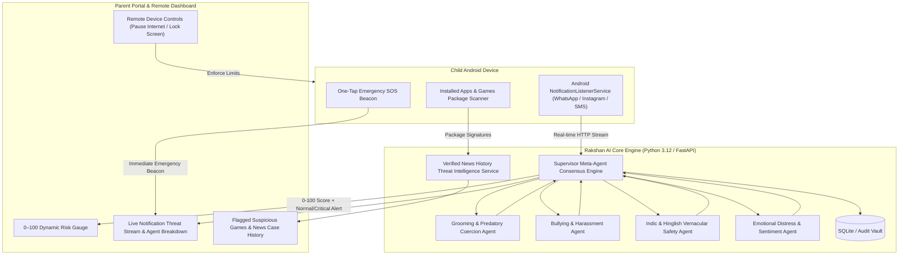

# 🛡️ Rakshan AI — Real-Time Child Cyber Safety, Risk Intelligence & Compliance Platform

> **College of Engineering Phaltan — Hackathon 2k26**  
> **Theme:** Child Cyber Safety  
> **Team:** Team Sion (`hack-team-sion`)  
> **Compliance:** DPDP Act 2023 (Sec 9) • POCSO Act 2012 (Sec 11/12) • IT Act 2000 (Sec 67B / 69A)

---

## 📌 Executive Summary
**Rakshan AI** is an advanced, privacy-aware child cyber-safety platform combining **Multi-Agent AI threat analysis**, **real-time Android notification interception**, and **previous news history threat intelligence** to protect minors from predatory grooming, vernacular extortion, cyberbullying, and dangerous gaming addictions.

Unlike basic keyword-blocking parental controls, Rakshan AI understands contextual semantics across English and vernacular languages (Hindi, Hinglish, Marathi) and calculates a real-time **0–100 Risk Score** with automated parental alert dispatch.

---

## ⚡ Key Real-Time Capabilities

### 1. 🔔 Real-Time Android Notification Interceptor & AI Risk Scoring
* **Native Background Service:** Intercepts incoming messages across WhatsApp, Instagram DM, Discord, Telegram, and SMS via Android's `NotificationListenerService`.
* **Zero-Delay Multi-Agent Analysis:** Every notification is evaluated within milliseconds through 4 specialized AI sub-agents and a consensus supervisor meta-agent.
* **Granular Harm Detection:**
  * **Predatory Grooming:** Secrecy enforcement (`"don't tell your mom"`), boundary violations, and private photo solicitations.
  * **Vernacular & Hinglish Extortion:** Local blackmail patterns (`"photo viral kar dunga"`, `"mummy papa ko mat bolna"`, UPI extortion).
  * **Cyberbullying & Harassment:** Peer insults, degradation slurs, social exclusion, and self-harm incitement.
  * **Emotional Distress:** Subtle isolation markers, panic, and distress sentiment.
* **Instant Risk Index (0–100):** Visual gauge reflecting severity (`SAFE`, `MEDIUM`, `HIGH`, `CRITICAL`) with recommended parental interventions.

### 2. 🎮 Suspicious Games & Previous News Threat Intelligence
* **On-Device Package Scanning:** Real-time scanning of installed applications and games on the child's device using Android's `PackageManager`.
* **Verified News History Cross-Matching:** Cross-references installed packages against verified Indian police FIRs, CERT-In advisories, and national news history:
  * **Free Fire / Free Fire MAX:** Flagged for severe addiction, predatory gambling loops, and cases where minors spent ₹1.2L–₹40L from parents' savings leading to fatal outcomes.
  * **Blue Whale Challenge / Curator APKs:** Flagged for lethal 50-day self-harm challenges and child suicide cases (Mumbai, Indore, global).
  * **Roblox:** Flagged under CERT-In & NCMEC advisories for online predator grooming in unregulated in-game virtual rooms.
  * **BGMI / PUBG Mobile:** Flagged for Section 69A IT Act history, aggression, sleep deprivation, and unmonitored voice chats.
  * **Real-Money Gaming & Betting (Teen Patti, Rummy, WinZO, Dream11):** Flagged for underage gambling debt traps and illicit UPI draining.
  * **Trojanized Modded APKs (HappyMod, Lucky Patcher):** Flagged for covert spyware, camera hijacking, and SMS OTP interception.
* **Remote Parental Enforcement:** One-tap remote internet pause, screen lock, bedtime curfews, and app blocking.

---

## 🏛️ System Architecture



---

## 📁 Repository Structure

```
hack-team-sion/
├── backend/                  # Python FastAPI Multi-Agent Engine
│   ├── app/
│   │   ├── agents/           # Specialized AI Micro-Agents (Grooming, Bullying, Indic, Emotion, Supervisor)
│   │   ├── api/              # REST Endpoints (Monitor, Notifications, Games, Auth, Pairing, Controls)
│   │   ├── models/           # Pydantic Schemas & SQLAlchemy ORM Models
│   │   ├── services/         # Game Threat Intelligence, Alert Dispatch, Compliance Service
│   │   ├── config.py         # System Settings & Risk Thresholds
│   │   ├── database.py       # Async Database Connection
│   │   └── main.py           # FastAPI Application Entrypoint
│   ├── requirements.txt      # Backend Dependencies
│   ├── run.py                # Server Runner (Uvicorn)
│   └── seed_demo_data.py     # Initial Compliance & Demo Fixtures
├── mobile_app/               # Flutter Cross-Platform Application
│   ├── android/              # Native Kotlin Bridge (NotificationListenerService, PackageManager)
│   ├── assets/               # Application Assets & Icons
│   ├── lib/
│   │   ├── core/             # Design System & Theme
│   │   ├── screens/          # Parent Dashboard, Live Notification Monitor, Suspicious Games Scanner
│   │   ├── services/         # API Service & Native MethodChannel Bridge
│   │   └── widgets/          # Risk Gauge, Incident Cards
│   └── pubspec.yaml          # Flutter Dependencies
├── .gitignore                # Professional Git Ignore Policy
└── README.md                 # Complete System Documentation
```

---

## 🚀 Quick Setup & Execution

### 1. Backend Server
```bash
cd backend
python -m venv venv
# On Windows:
.\venv\Scripts\activate
pip install -r requirements.txt
python run.py
```
* **API Server:** `http://localhost:8000`
* **Interactive Swagger Documentation:** `http://localhost:8000/docs`

### 2. Mobile App (Connected Android Device)
```bash
# Forward port for connected USB Android device
adb reverse tcp:8000 tcp:8000

cd mobile_app
flutter pub get
flutter run
```

---

## 📜 Statutory Compliance
* **DPDP Act 2023 (Section 9):** Strict parental consent protocols, on-device redaction, and prohibition of harmful behavioural tracking targeting minors.
* **POCSO Act 2012 (Sections 11 & 12):** Cryptographic evidence preservation of grooming, solicitation, and harassment logs without raw photo exposure.
* **Information Technology Act 2000 (Section 67B & 69A):** Structured digital audit trail supporting Indian cyber law reporting.
